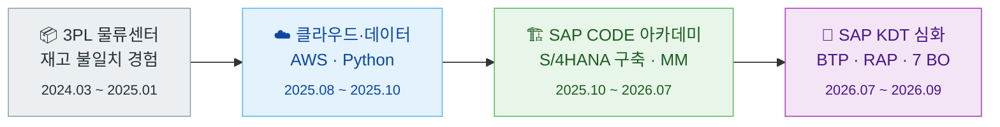
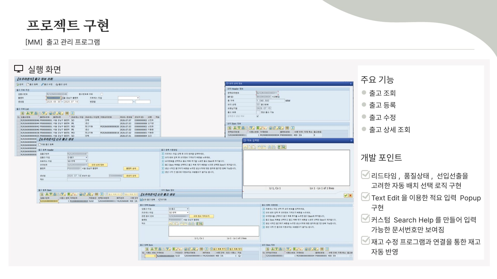
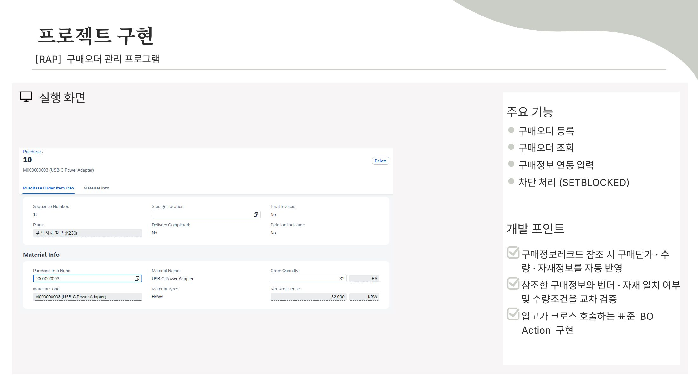
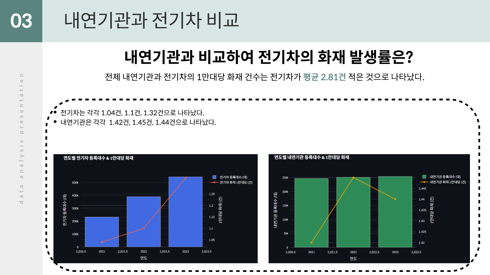

<div align="center">


### 화면에서 데이터베이스까지, 데이터 흐름을 추적해 문제를 해결하는 SAP ABAP 개발자

<p>


</p>

<p>


</p>

</div>

---

## 👋 About Me

> 물류센터에서 **시스템 재고와 실물 수량이 맞지 않는 문제**를 직접 겪고, 데이터가 발생 시점부터 정확히 이어지는 시스템을 만들기 위해 SAP를 선택했습니다.

- 🏗️ **S/4HANA 구축 프로젝트**에서 MM 모듈(재고·자재·출고)을 개발하고 부PM을 맡았습니다.
- ☁️ **SAP BTP · RAP**로 자재부터 구매오더·입고까지 7개 Business Object를 설계·개발했습니다.
- 🔍 결과가 이상하면 **화면 → 로직 → DB** 순서로 데이터 흐름을 따라가며 원인을 찾습니다.



---

## 🏆 SAP Projects

<table>
<tr>
<td width="50%" valign="top">

### 🏗️ [F&B 기업 S/4HANA 구축 – MM 재고·출고](sap-code-s4hana-project/)
<sub>SAP CODE 아카데미 1기 · 팀 프로젝트 · 2026.03 ~ 2026.07</sub>

<a href="sap-code-s4hana-project/"></a>

**역할** MM 개발 · 부PM (WBS · 주간 진척 · 산출물)

- 생산·판매·창고이동 **3유형 출고**를 한 처리 단위로 등록
- **선입선출 배치 자동 선택** (품질 불합격·관리종료 제외)
- 품질보증기간 기준 **품질상태 업데이트 배치**
- UI5 + OData **재고 조정 · 폐기대상 모니터링**

    

</td>
<td width="50%" valign="top">

### 🚀 [S-Mobile RAP 기반 S/4HANA 전환 – MM 구매·입고](sap-kdt-rap-project/)
<sub>SAP KDT 심화과정 2기 · 2026.07 ~ 2026.09</sub>

<a href="sap-kdt-rap-project/"></a>

**역할** ERD 설계 · Business Object 7개 개발

- 자재 · 벤더 · G/L 계정 · 계정결정 · PIR · **PO · GR**
- **UUID 기술키**와 Number Range 업무 번호 분리
- 입고 저장 시 **Action으로 PO 입고완료** 자동 동기화
- 🏅 **조별 평가우수자** 선정 · 수료식 최종 발표

    

</td>
</tr>
</table>

### 🔧 Troubleshooting Highlights

| | 문제 | 해결 | 결과 |
|:-:|---|---|---|
| 🔴 | 다품목 출고 시 재고 값이 덮어써짐 | 관련 재고를 Internal Table에 모아 일괄 계산 후 한 번에 DB 반영, `COMMIT`/`ROLLBACK` 정리 | **정합성 오류 0건** |
| 🟠 | ALV Toolbar 클릭 후 Screen 필드 미갱신 | `sy-ucomm`을 Enter로 바꿔 PAI → PBO 흐름을 타도록 처리 | ALV · Screen 동시 반영 |
| 🟡 | 생산 불가 원자재가 출고에 등록됨 | 자재 그룹별로 상태·날짜 조건을 나눠 검증 | 사용 가능 자재만 등록 |
| 🔵 | 입고(GR) · 구매오더(PO) 상태 불일치 | PO BO에 `SetGrComplete` Action 선언, GR 저장 시 EML로 호출 | 입고 시 PO 자동 완료 |
| 🟣 | 여러 PO Item 동시 추가 시 번호 충돌 | Early Numbering에서 최대 번호 조회 후 +10 채번 | 10 · 20 · 30… 순차 부여 |

<sub>👉 원인 분석과 발표 자료는 각 프로젝트 README의 트러블슈팅 섹션에 있습니다.</sub>

---

## 🧩 Other Projects

<table>
<tr>
<td width="50%" valign="top">

### 📊 [전기차 화재 분석 대시보드](ev-fire-analysis/)
<sub>새싹(SeSAC) 개인 프로젝트 · 2025.08 ~ 2025.09</sub>

<a href="ev-fire-analysis/"></a>

- 소방청 화재 통계 **약 11만 건** 전처리
- 등록 대수 대비 **1만 대당 화재율** 비교
- 전기차가 내연기관보다 **연평균 0.28건 적음**
- Streamlit Cloud 배포 → [대시보드 열기](https://evfireanalysisproject-e7ygs7vzz6b8zysrmiv7nz.streamlit.app/)

   

</td>
<td width="50%" valign="top">

### 🎮 [모션 인식 게임 (Unity)](motion-game/)
<sub>대학 팀 프로젝트 · 2023.03 ~ 2023.12</sub>

```
 [웹캠] ─▶ Python (손·몸 인식)
             │  UDP 5052
             ▼
 [Unity] ─▶ 몸 동작으로 게임 조작
```

- 웹캠 하나로 **몸 33개 · 손 21개** 랜드마크 인식
- 인식·통신 공통부 개발 (Python → UDP → C#)
- **장애물 회피**: 손 들기 = 점프, 팔 뻗기 = 좌우 이동
- **아이템 전달**: 손가락으로 집어 캐릭터에게 전달

   

</td>
</tr>
</table>

---

## 🛠️ Skills

<table>
<tr>
<th width="33%">💻 SAP Development</th>
<th width="33%">⚙️ SAP Technical</th>
<th width="33%">📚 ERP Knowledge</th>
</tr>
<tr>
<td valign="top">

- ABAP Report · Module Pool
- ALV Grid · Tree · Event
- Gateway OData · SAPUI5
- CDS View · RAP

</td>
<td valign="top">

- Open SQL · Debugging
- DDIC · Function Module
- Class / OOP
- BAPI / RFC

</td>
<td valign="top">

- MM 재고 · 구매
- Batch Management
- 유효기간 · FEFO
- FI 문서 흐름 · PP / SD

</td>
</tr>
</table>

<div align="center">


</div>

---

## 🎓 Education & 📜 Certifications

<table>
<tr>
<td width="50%" valign="top">

**🎓 Education**

| 기간 | 과정 |
|---|---|
| 2026.07 ~ 2026.09 | **SAP KDT 심화과정 2기** · 320h |
| 2025.10 ~ 2026.07 | **SAP CODE 아카데미 1기** · 1,440h |
| 2025.08 ~ 2025.10 | 새싹(SeSAC) 클라우드 데이터 엔지니어 과정 (수강) |

</td>
<td width="50%" valign="top">

**📜 Certifications**

| 취득 | 자격 |
|---|---|
| 2026.06 | 🟦 **SAP Certified** – Back-End Developer – ABAP Cloud |
| 2026.06 | 🟦 **SAP Certified** – S/4HANA Cloud Private Edition, FI |
| 2026.03 | 🗄️ SQL 개발자 (SQLD) |
| 2025.06 | 🧾 전산회계 2급 |

</td>
</tr>
</table>

<div align="center">


</div>
