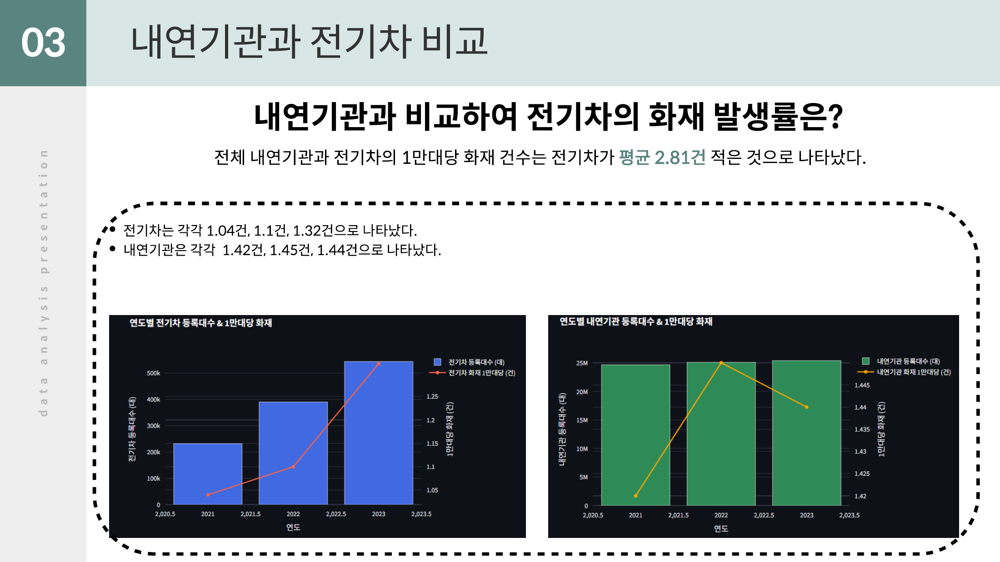
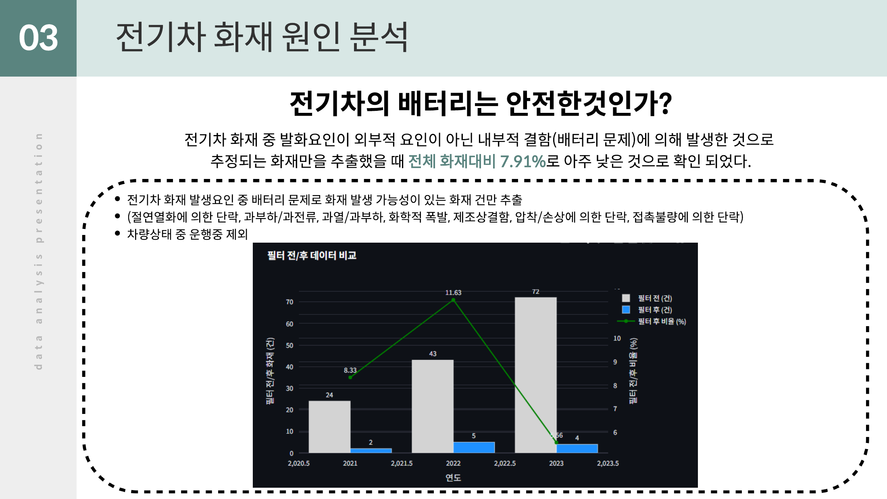
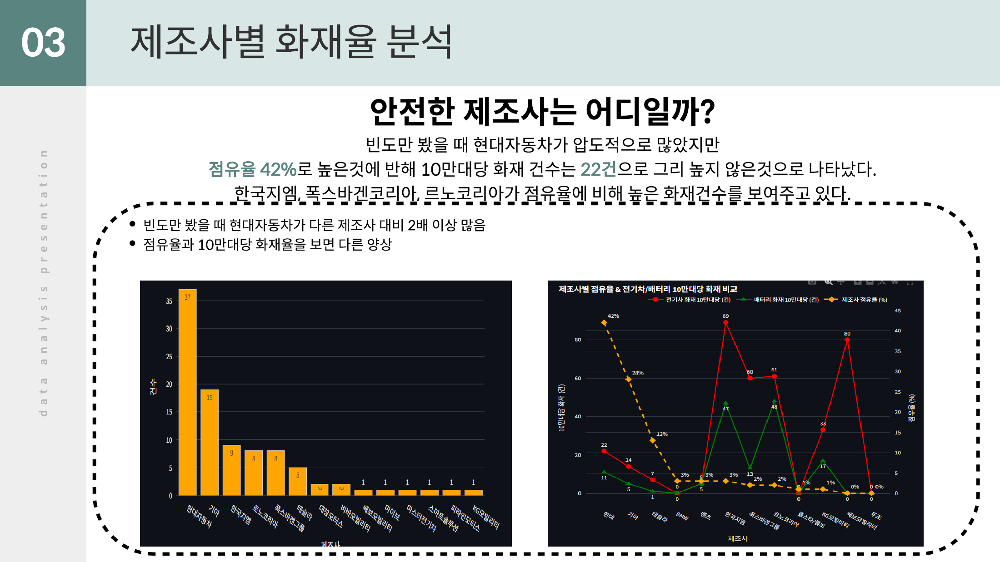
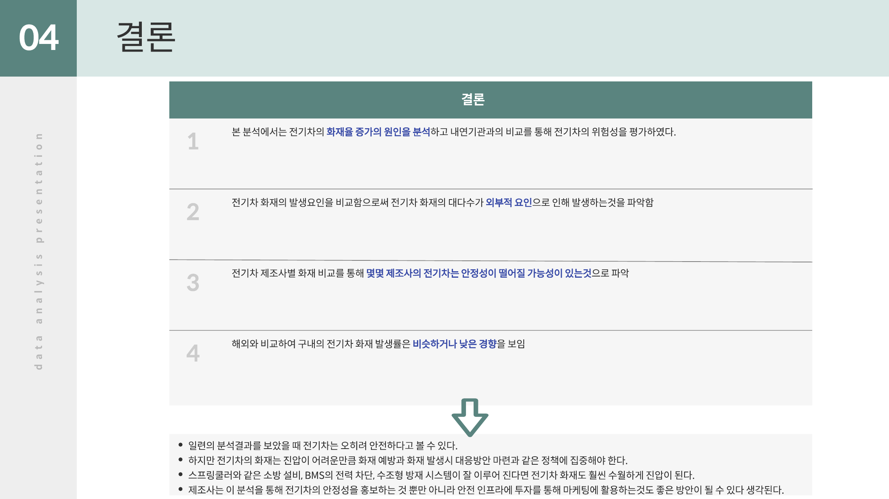

# 전기차 화재 분석 대시보드

> 새싹(SeSAC) × 베스핀글로벌 「AI서비스 운영을 위한 클라우드 데이터 엔지니어」 과정 개인 프로젝트 (2025.08 ~ 2025.09)
> "전기차는 정말 내연기관차보다 화재 위험이 높을까?"를 공공데이터로 검증하고, Streamlit 대시보드로 시각화

| 항목 | 내용 |
|---|---|
| 형태 | 개인 프로젝트 (기획 · 데이터 수집·가공 · 분석 · 대시보드 개발 · 발표) |
| 기술 | Python, pandas, Plotly, Streamlit, Google Colab |
| 대시보드 | [Streamlit Cloud 배포본](https://evfireanalysisproject-e7ygs7vzz6b8zysrmiv7nz.streamlit.app/) |
| 산출물 | [분석 기획서](docs/분석_아이디어_기획서.docx) · [발표 자료](docs/전기차_화재_분석_발표자료.pdf) |

---

## 1. 분석 배경과 질문
전기차 보급이 늘면서 전기차 화재 보도도 늘었지만, 화재 **건수**만 비교하면 보급 대수 증가 효과를 반영하지 못합니다. 그래서 아래 세 가지 질문을 세웠습니다.
1. **보급 대수 대비** 전기차의 화재 발생률은 내연기관차보다 높은가?
2. 전기차 화재 원인은 외부 요인인가, 배터리 같은 내부 결함인가?
3. 국내 전기차 화재율은 해외·제조사별로 비교하면 어떤 수준인가?

## 2. 데이터

| 파일 | 출처 | 내용 |
|---|---|---|
| `통합_화재_통계.csv` | 소방청 연간화재통계 2021~2023 (공공데이터포털) | 전체 화재 약 11.5만 건 → 승용·화물자동차·버스 화재 10,936건 추출 |
| `전기차_화재_통계.csv` | 소방청 전기차 화재 발생 현황 (공공데이터포털) | 전기차 화재 139건 (발화요인, 차량상태 등) |
| `자동차_등록_대수_현황.csv` | 국토교통부 보도자료(PDF) → CSV로 변환 | 연도별 전체·전기차 등록 대수 |
| `차종별_전기차_화재.csv` | 국토교통부 통계누리 | 제조사·차명별 최초 발화점, 상황 |
| `전기차_제조사_점유율_화재.csv` | 공개 자료 정리 | 제조사별 누적 판매, 점유율, 10만 대당 화재 |
| `해외_전기차_화재.csv` | 공개 자료 정리 | 국가별 1만 대당 전기차·내연기관차 화재 |

- 연도별 원본 화재 통계 3개 파일을 하나로 합치고, 장소 소분류가 차량(승용·화물·버스)인 건만 남겼습니다.
- PDF로만 제공되는 등록 대수는 직접 표로 옮겨 CSV로 만들었습니다.

## 3. 분석 방법
- **1만 대당 화재 건수** = 연도별 화재 건수 ÷ 연도별 등록 대수 × 10,000
  - 내연기관차 화재 = 차량 화재 전체 − 전기차 화재
  - 내연기관차 등록 대수 = 전체 등록 대수 − 전기차 등록 대수
- 발화 요인·차량 상태(주차·충전·주행)별 분포
- 최초 발화점이 고전압 배터리이면서 충돌 사고가 아닌 화재를 "배터리 내부 결함 추정"으로 분류
- 제조사별 점유율 대비 10만 대당 화재, 국가별 1만 대당 화재 비교

## 4. 결과

| 연도 | 전기차 화재 (건) | 전기차 1만 대당 | 내연기관차 1만 대당 |
|---|---|---|---|
| 2021 | 24 | 1.04 | 1.42 |
| 2022 | 43 | 1.10 | 1.45 |
| 2023 | 72 | 1.32 | 1.44 |
| **평균** | | **1.15** | **1.44** |

- 전기차 화재 건수는 3년간 3배 늘었지만, 같은 기간 등록 대수도 2.3배 늘었습니다. 등록 대수 대비로 보면 **전기차가 내연기관차보다 1만 대당 연평균 약 0.28건 적게** 발생했습니다.
- 배터리 내부 결함으로 추정되는 화재는 전체 대비 **7.91%**로 낮은 수준이었습니다. (발표 자료 기준)
- 제조사별로는 점유율이 높은 현대·기아·테슬라가 10만 대당 화재가 낮고, 점유율이 낮은 일부 제조사는 높게 나타났습니다.
- 국내 전기차 1만 대당 화재(1.04~1.32건)는 해외 주요국과 비슷하거나 낮은 수준이었습니다.

> 위 표는 이 저장소의 `data/` 파일로 다시 계산해 확인한 값입니다.

| 등록 대수 대비 화재 비교 | 전기차 화재 원인 |
|---|---|
|  |  |
| **제조사별 화재율** | **결론** |
|  |  |

## 5. 대시보드 구성 (`app.py`)

| 탭 | 내용 |
|---|---|
| 주요 분석 | KPI 카드(전체·전기차 화재 건수, 비율), 연도별 화재·등록 대수 누적 막대 + 비율 선, 전기차·내연기관 1만 대당 화재 비교, 자동 생성 인사이트 |
| 필터링 분석 | 사이드바에서 연도·발화요인·차량상태를 골라 발화요인 막대, 차량상태 도넛, 필터 전/후 비교 차트 확인 |
| 추가 참고 분석 | 제조사별 화재·점유율 비교, 최초 발화점·상황 도넛, 배터리 화재 KPI, 국가별 1만 대당 화재 |

## 6. 실행 방법
```bash
pip install -r requirements.txt
cd data && streamlit run ../app.py
```
`app.py`는 CSV 파일을 현재 폴더 기준으로 읽기 때문에 `data` 폴더에서 실행합니다.

## 7. 한계
- 분석 기간이 2021~2023년 3년이라, 추세를 단정하기에는 짧습니다.
- 전기차 화재 원인 데이터 중 "미상"이 많아 원인 분류에 한계가 있습니다.
- 제조사·해외 비교 데이터는 공개 자료를 직접 정리한 것으로, 집계 기준이 출처마다 다를 수 있습니다.
