# F&B 기업 SAP S/4HANA 구축 프로젝트 – MM 재고·출고 영역

> SAP CODE 아카데미 1기 팀 프로젝트 (2026.03 ~ 2026.07)
> 가상 F&B 기업 "도우라운지"의 MM·SD·FI·PP 업무를 S/4HANA 환경에서 구현

| 항목 | 내용 |
|---|---|
| 팀 / 역할 | A3 조 / **MM 모듈 개발(재고·자재·출고)**, 부PM(WBS 관리, 주간 진척 보고, 산출물 관리) |
| 개발 환경 | SAP S/4HANA (Release 758), SAP GUI, ABAP Workbench, SAP Gateway, SAP Business Application Studio |
| 사용 기술 | Classic ABAP (Module Pool, ALV Grid, ALV Tree, Report, Batch Job), Open SQL, Number Range, BDC, SAP Gateway(OData V2), SAPUI5 |
| 공개 범위 | 본인이 개발한 MM 6000번대 프로그램만 포함. 다른 팀원이 개발한 프로그램과 교육과정 예제 코드는 제외 |

---

## 1. 업무 흐름과 담당 범위

```
 [구매·입고(MM)] ──▶ [배치 생성 / 재고] ──▶ [출고] ──┬─▶ 생산오더 투입 (PP)
                         ▲      │                   ├─▶ 판매오더 출하 (SD)
                         │      ▼                   └─▶ 창고 이동 (MM)
                         │  [품질상태 배치]
                         │   생산일자 + 품질보증기간 기준
                         │   만료 배치 → 폐기 창고(SL05)
                         └── [재고 집계 · 생산오더 출고 현황 조회]
```

이 중 **재고·자재·출고와 그 조회·배치 프로그램**을 담당했습니다. (위 그림에서 구매·입고·배치 생성은 다른 팀원 담당)

<details>
<summary>도우라운지 전체 비즈니스 프로세스 흐름도 (발표 자료)</summary>

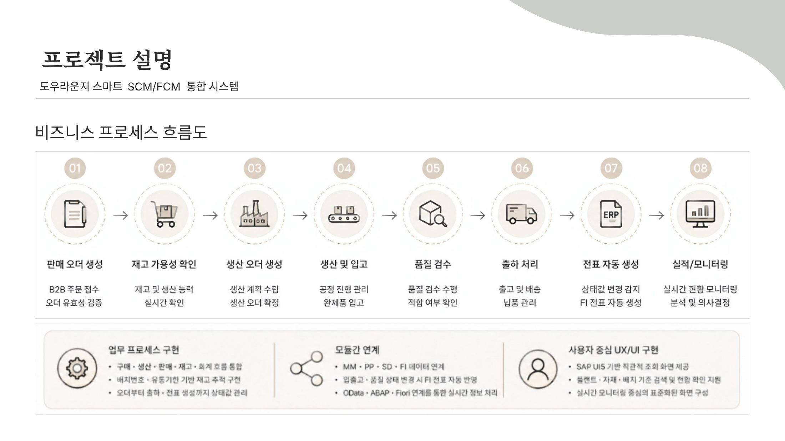
</details>

## 2. 개발 프로그램

| 구분 | 프로그램 | 이름 | 주요 기능 |
|---|---|---|---|
| Module Pool | `SAPMZA3MM6001` | 재고 관리 | 재고 조회·등록·수정, 배치·자재·플랜트 상세 조회, 함수 모듈 4개 |
| Module Pool | `SAPMZA3MM6002` | 자재 관리 | 자재 마스터 조회·신규 등록·수정 |
| Module Pool | `SAPMZA3MM6003` | 출고 관리 | 생산·판매·창고이동 3가지 유형의 출고 생성·수정·조회 |
| Report | `ZRA3MM6001` | 재고 집계 조회 | 자재·플랜트·배치별 가용/폐기 재고 집계 |
| Report | `ZRA3MM6002` | 생산오더 출고 현황 조회 | 생산오더별 자재 투입(출고) 상태 모니터링 (ALV Tree + Grid) |
| Batch | `ZRA3MM6003` | 품질상태 업데이트 배치 | 품질보증기간 기준 배치 품질상태 갱신, 만료 재고 폐기 창고 이동, 처리 로그 |
| Gateway | `ZCL_ZGWA3MM6001_DPC_EXT` | 재고 집계 OData | 재고 집계 목록, 자재 상세, 자재·플랜트 Search Help |
| Gateway | `ZCL_ZGWA3MM6002_DPC_EXT` | 재고 조정 OData | 재고·배치·저장위치 조회, 재고 조정 등록(Create) |
| Gateway | `ZCL_ZGWA3MM6003_DPC_EXT` | 폐기 대상 OData | 폐기 대상 배치 목록·차트 데이터 |
| SAPUI5 | `zgwa3mm6001` | 재고 집계 조회 | 조건 검색, Search Help, 자재 상세 화면 이동(Routing) |
| SAPUI5 | `zgwa3mm6002` | 재고 조정 | 재고 조회·차트, 증가/감소 조정 등록 (재고 실사 결과 반영) |
| SAPUI5 | `zgwa3mm6003` | 폐기 대상 조회 | 폐기 대상 배치 목록과 도넛 차트 |

### 프로그램별 실행 화면과 개발 포인트
각 항목을 펼치면 실행 화면과 개발 포인트를 볼 수 있습니다.

<details>
<summary><b>출고 관리 (SAPMZA3MM6003)</b></summary>

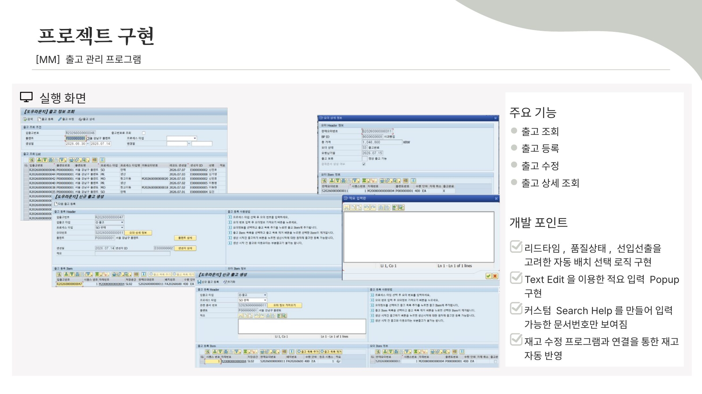

- 리드타임·품질상태·선입선출을 고려한 자동 배치 선택 로직
- Text Edit 컨트롤을 이용한 적요 입력 Popup
- 커스텀 Search Help로 입력 가능한 문서번호만 표시
- 재고 수정 프로그램과 연결해 출고 시 재고 자동 반영
</details>

<details>
<summary><b>재고 관리 (SAPMZA3MM6001)</b></summary>

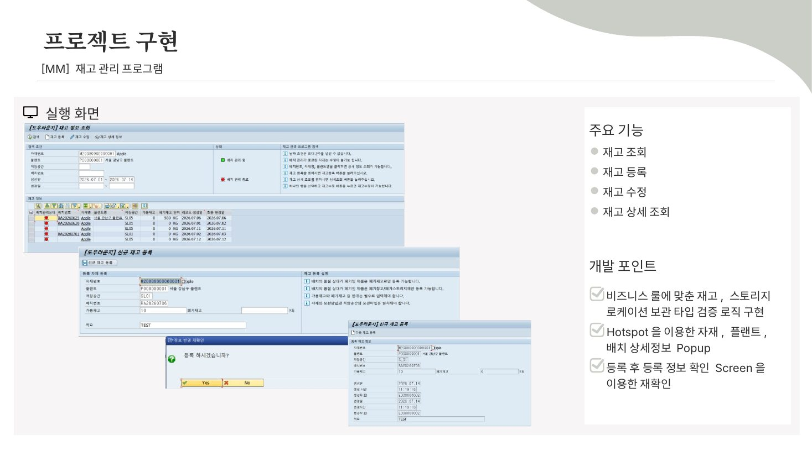

- 비즈니스 룰에 맞춘 재고·저장위치 보관 타입 검증 로직
- Hotspot으로 자재·플랜트·배치 상세정보 Popup
- 등록 후 확인 Screen으로 등록 정보 재확인
</details>

<details>
<summary><b>자재 관리 (SAPMZA3MM6002)</b></summary>

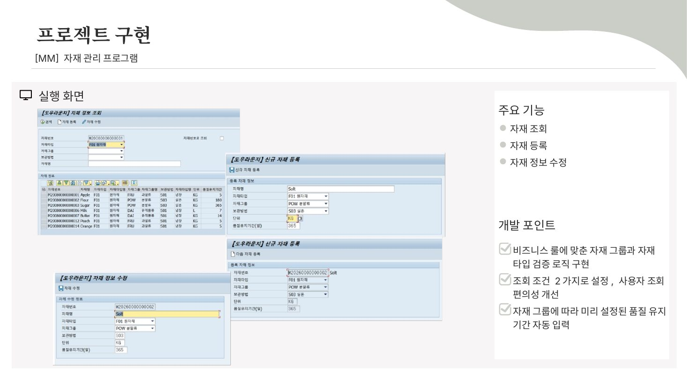

- 비즈니스 룰에 맞춘 자재 그룹·자재 타입 검증 로직
- 조회 조건을 2가지로 나눠 사용자 조회 편의성 개선
- 자재 그룹에 따라 미리 정한 품질 유지 기간 자동 입력
</details>

<details>
<summary><b>재고 집계 조회 (ZRA3MM6001)</b></summary>

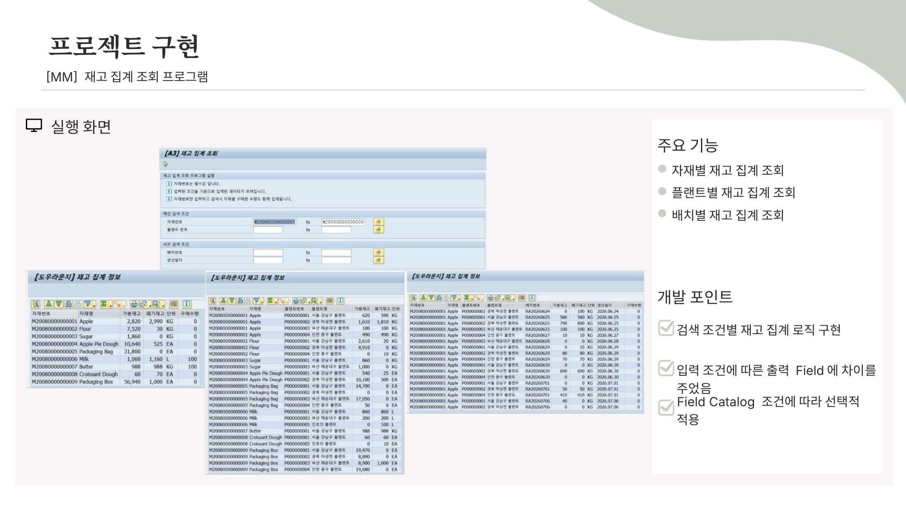

- 검색 조건(자재·플랜트·배치)별 재고 집계 로직
- 입력 조건에 따라 출력 필드를 다르게 구성
- 조건에 따라 Field Catalog를 선택적으로 적용
</details>

<details>
<summary><b>생산오더 출고 현황 조회 (ZRA3MM6002)</b></summary>

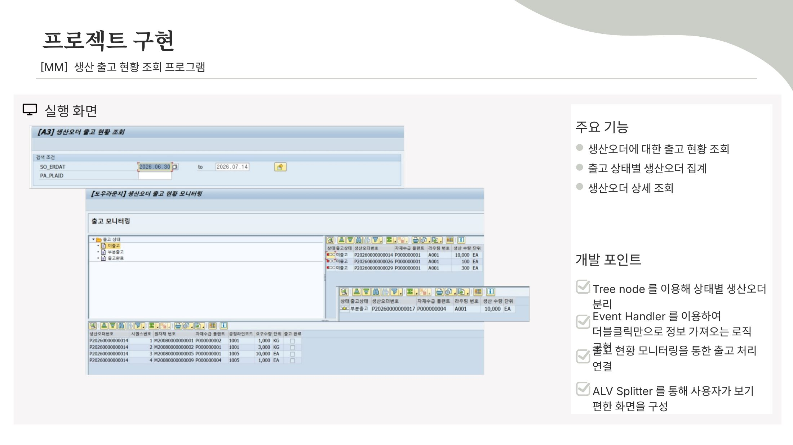

- Tree Node로 출고 상태별 생산오더 분리
- Event Handler로 더블클릭만으로 상세 정보 조회
- ALV Splitter로 한 화면에 트리와 목록을 함께 구성
- 출고 현황 모니터링에서 출고 처리로 연결
</details>

<details>
<summary><b>품질상태 업데이트 배치 (ZRA3MM6003)</b></summary>

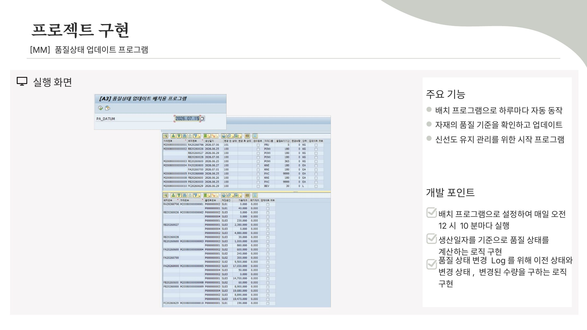

- 배치 Job으로 등록해 매일 오전 12시 10분 자동 실행
- 생산일자를 기준으로 품질 상태를 계산하는 로직
- 변경 이력을 위해 이전 상태·변경 상태·변경 수량을 Log로 기록
</details>

<details>
<summary><b>재고 조정 – SAPUI5 (zgwa3mm6002)</b></summary>

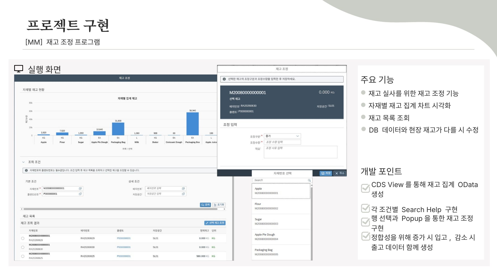

- CDS View로 재고 집계 OData 구성
- 조건별 Search Help
- 행 선택과 Popup으로 재고 조정, 자재별 재고 차트
- 정합성을 위해 증가 시 입고, 감소 시 출고 데이터를 함께 생성
</details>

<details>
<summary><b>폐기대상 재고 모니터링 – SAPUI5 (zgwa3mm6003)</b></summary>

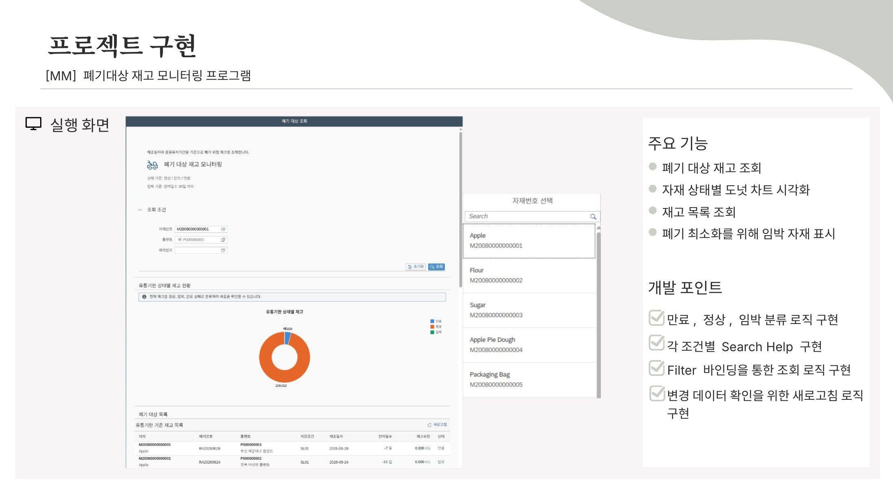

- 만료·임박·정상 분류 로직
- 조건별 Search Help와 Filter 바인딩 조회
- 자재 상태별 도넛 차트, 변경 데이터 확인용 새로고침
- 폐기 최소화를 위해 임박 자재 표시
</details>

## 3. 주요 구현 내용

### 3-1. 출고 관리 (`SAPMZA3MM6003`) – 출고 유형별 연계 처리
- 출고 유형을 **생산(PR) / 판매(SO) / 창고이동(MO)**으로 나누고, 유형에 따라 생산오더·판매오더·이동오더의 품목을 가져와 출고 품목을 구성합니다.
- 출고 등록 시 하나의 처리 단위로 아래 순서를 수행합니다.
  1. 입력 검증 (출고 품목 존재, 오더 번호, 오더 상태)
  2. 등록 재확인 팝업
  3. Number Range(`NUMBER_GET_NEXT`)로 출고 번호 채번
  4. 출고 Header → Item 등록
  5. 출고 유형에 맞는 오더 상태 변경 (생산오더 / 판매오더 / 이동오더)
  6. 재고 수량 차감
  7. 모든 단계가 성공하면 `COMMIT WORK`, 한 단계라도 실패하면 `ROLLBACK WORK`
- 오더 번호는 `F4IF_INT_TABLE_VALUE_REQUEST`로 Search Help를 구성해, 사용자가 직접 입력하지 않고 선택하도록 했습니다.

### 3-2. 선입선출 배치 자동 선택
출고할 배치는 **생산일자(HSDAT) 오름차순**으로 조회하고, 품질 불합격(`QUALT = '300'`)과 관리종료(`DFLAG = 'X'`) 배치, 가용 재고가 0인 배치는 제외합니다.

```abap
SELECT a~matid, plaid AS plaid1, stoid, a~batid, labst,
       scrap, hsdat, qualt, meins, maqua
  FROM zta3mm0002 AS a
 INNER JOIN zta3mm0003 AS b ON a~matid = b~matid AND a~batid = b~batid
 INNER JOIN zta3mm0001 AS c ON a~matid = c~matid
  INTO CORRESPONDING FIELDS OF TABLE @ct_proc1
 WHERE a~matid = @p_matid
   AND a~plaid = @p_plaid
   AND b~qualt <> '300'      " 품질 불합격 제외
   AND b~dflag <> 'X'        " 관리종료 배치 제외
   AND a~labst <> 0          " 가용 재고 없는 배치 제외
 ORDER BY hsdat ASCENDING.   " 생산일자가 빠른 배치부터
```
→ [`MZA3MM6003F01.abap`](abap/SAPMZA3MM6003_goods-issue/MZA3MM6003F01.abap) `FORM get_inventory_info`

### 3-3. 품질상태 업데이트 배치 (`ZRA3MM6003`)
- 배치별로 **생산일자 + 자재의 품질보증기간**을 계산해(`RP_CALC_DATE_IN_INTERVAL`) 품질상태를 갱신합니다.
  - 기간 경과 → 폐기(`300`), 관리종료 처리
  - 과일류(`FRU`)는 품질보증기간의 1~2배 구간을 주의(`101`)로 두고, 2배를 넘으면 폐기
- 폐기 판정된 배치의 가용 재고는 **폐기 창고(`SL05`)로 이동**시키고(가용 → 폐기 수량), 변경 내역을 Number Range로 채번한 로그 테이블에 남깁니다.
- 배치 상태 갱신·재고 이동·로그 기록 중 하나라도 실패하면 `ROLLBACK WORK` 합니다.

### 3-4. 조회·모니터링
- **재고 집계 조회 (`ZRA3MM6001`)**: `GROUP BY`와 `SUM`으로 자재·플랜트·배치별 가용/폐기 재고를 집계합니다.
- **생산오더 출고 현황 (`ZRA3MM6002`)**: Docking Container와 Splitter로 화면을 나누고, ALV Tree(생산오더)와 ALV Grid(투입 자재)로 출고 상태를 함께 보여 줍니다.
- **재고 집계 조회 앱 (`zgwa3mm6001`)**: OData 필터(`BT`/`EQ`)로 자재·플랜트·생산일자 범위를 조회하고, 목록에서 자재를 누르면 상세 화면으로 이동합니다.
- **폐기 대상 조회 앱 (`zgwa3mm6003`)**: 폐기 대상 배치를 목록과 도넛 차트(VizFrame)로 보여 줍니다.

### 3-5. 재고 조정 (`zgwa3mm6002` + `ZCL_ZGWA3MM6002_DPC_EXT`)
재고 실사 결과처럼 시스템 재고와 실물 수량이 다를 때 재고를 증가(`A`)·감소(`S`)로 조정합니다.
- **화면(UI5)**: 조정 구분 미선택, 0 이하 수량, 현재 재고보다 큰 감소 수량을 저장 전에 막습니다.
- **서버(OData Create)**: 같은 조건을 서버에서 다시 검증한 뒤 아래 순서로 처리합니다.
  1. 현재 재고 조회
  2. Number Range로 입출고 문서 번호 채번
  3. 재고 수량 변경
  4. 입출고 Header·Item 생성
  5. 모든 단계가 성공하면 `COMMIT WORK`, 실패하면 `ROLLBACK WORK`
- 재고를 바꿀 때 입출고 문서를 함께 남겨, 조정 내역을 나중에 추적할 수 있게 했습니다.

## 4. 트러블슈팅

| # | 문제 | 원인 | 해결 | 결과 |
|---|---|---|---|---|
| 1 | ALV Toolbar 버튼 클릭 후 상단 Screen 필드 값이 갱신되지 않음 | ALV `USER_COMMAND` 이벤트는 Dynpro PAI/PBO 흐름과 분리되어 있어, 내부 데이터만 바뀌고 PBO를 타지 않음 | 버튼 이벤트에서 `sy-ucomm`을 Enter로 바꿔 PAI를 타게 하고, Enter 처리에서 Screen 필드 값을 채움 | ALV와 Screen 값이 동시에 반영됨 |
| 2 | 다품목 출고 시 재고 수량이 실제와 다르게 반영됨 | Loop마다 DB에서 재고를 다시 읽어, 앞서 차감한 값이 원본으로 덮어써짐 | 관련 재고만 Internal Table에 담아 모든 변경을 계산한 뒤 한 번에 DB 반영, 오류 시 `COMMIT`/`ROLLBACK`으로 함께 취소 | 교차 테스트에서 정합성 오류 0건 |
| 3 | 생산에 쓸 수 없는 품질의 원자재가 생산오더 출고에 등록됨 | 자재 그룹마다 사용 가능 조건이 다른데 공통 조건만 검증 | 자재 그룹별로 상태 필드와 날짜 조건을 나눠 검증하고, 사용 불가 원자재는 후보에서 미리 제외 | 생산 가능한 품질의 자재만 등록됨 |
| 4 | 일부 자재의 품질 상태가 비즈니스 룰대로 바뀌지 않음 | 상태 판단 조건이 여러 기준·여러 테이블에 걸쳐 있는데 단일 조건만 검증 | 테이블별로 검증에 필요한 데이터를 함께 읽도록 SQL을 고치고, 상태 변경 필요 여부를 단계별로 검증 | 모든 자재의 상태가 검증 후 정확히 변경됨 |

<details>
<summary>트러블슈팅 발표 자료 보기</summary>

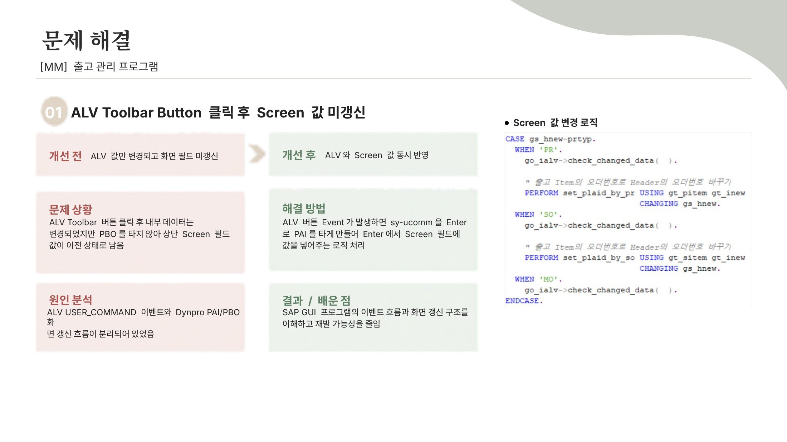
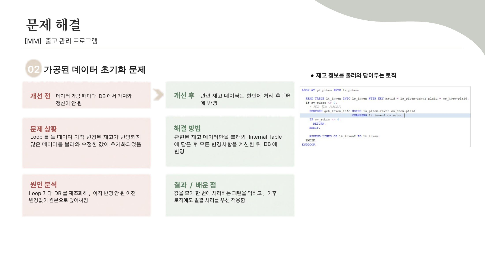
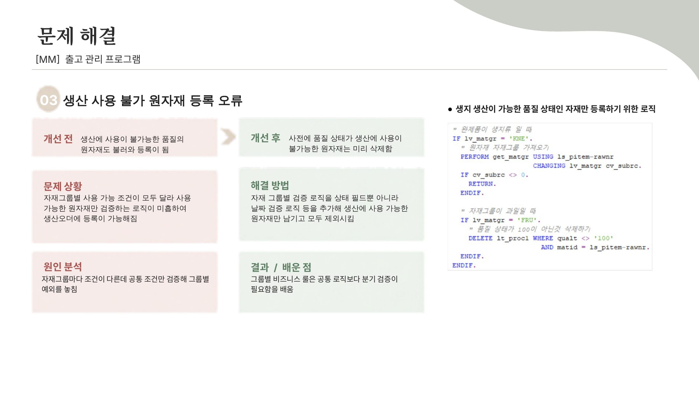
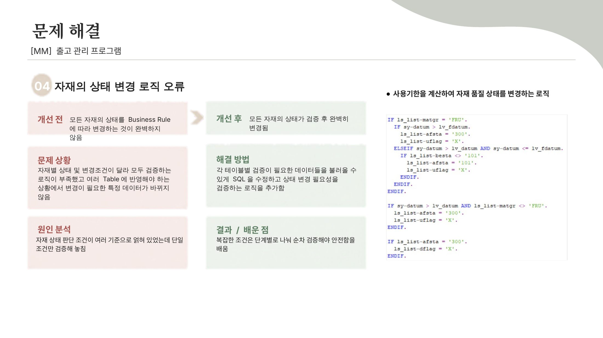
</details>

## 5. 폴더 구조

```
sap-code-s4hana-project/
├── abap/
│   ├── SAPMZA3MM6001_inventory-management/   # 재고 관리 (Module Pool)
│   ├── SAPMZA3MM6002_material-master/        # 자재 관리 (Module Pool)
│   ├── SAPMZA3MM6003_goods-issue/            # 출고 관리 (Module Pool)
│   ├── ZRA3MM6001_stock-summary-report/      # 재고 집계 조회 (Report)
│   ├── ZRA3MM6002_production-issue-monitor/  # 생산오더 출고 현황 (Report)
│   └── ZRA3MM6003_quality-status-batch/      # 품질상태 업데이트 (Batch)
│       ├── *.abap            # 메인 프로그램과 Include (TOP / O01 / I01 / F01 / C01)
│       ├── function_modules/ # 프로그램에서 사용하는 함수 모듈
│       └── screens/          # Screen(Dynpro) · GUI Title 정의
├── gateway/                  # OData 서비스 DPC_EXT 클래스
├── ddic/                     # 프로그램이 사용하는 Structure · Table 정의 (Markdown)
├── ui5/                      # SAPUI5 앱 3개 (재고 집계 조회 / 재고 조정 / 폐기 대상 조회)
└── images/                   # 발표 자료의 실행 화면·트러블슈팅 슬라이드
```

- Include 접미사: `TOP` 전역 선언 · `O01` PBO 모듈 · `I01` PAI 모듈 · `F01` 서브루틴 · `C01` 로컬 클래스(이벤트 핸들러)
- ABAP 소스는 SAP 시스템에서 Mass Download로 내보낸 파일을 `.abap` 텍스트로 변환한 것입니다.
- `ddic/tables`의 테이블 중 일부는 팀 공용 테이블로, 프로그램 이해를 돕기 위해 참조용으로 포함했습니다.
- 서버 주소와 클라이언트 번호 등 접속 정보는 `<SAP_BACKEND_HOST>`, `<SAP_CLIENT>`로 가렸습니다.
