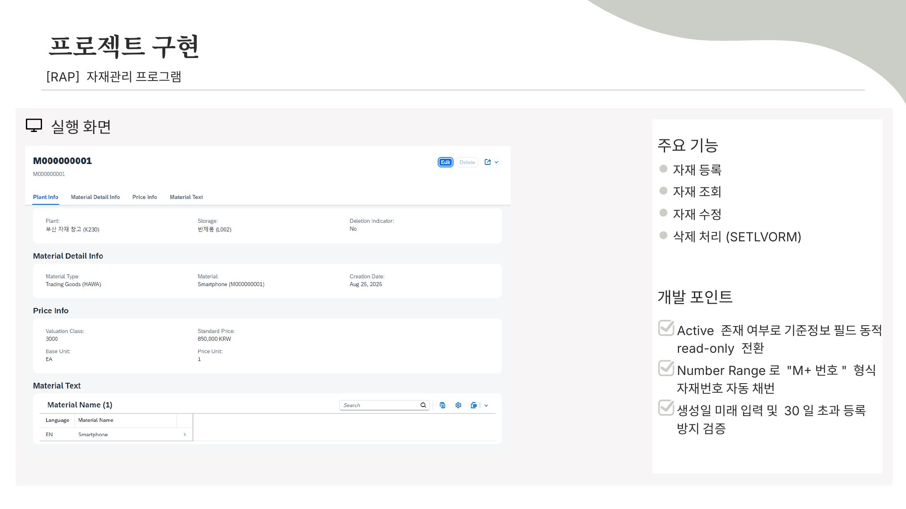
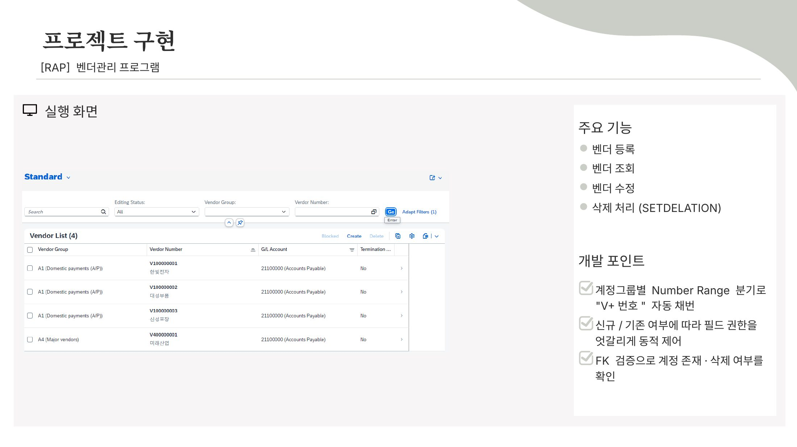
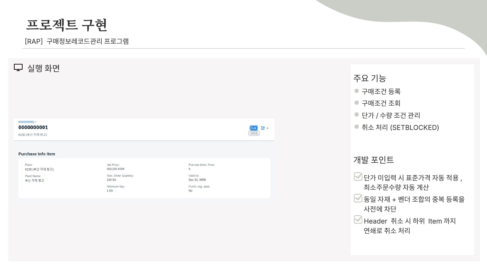
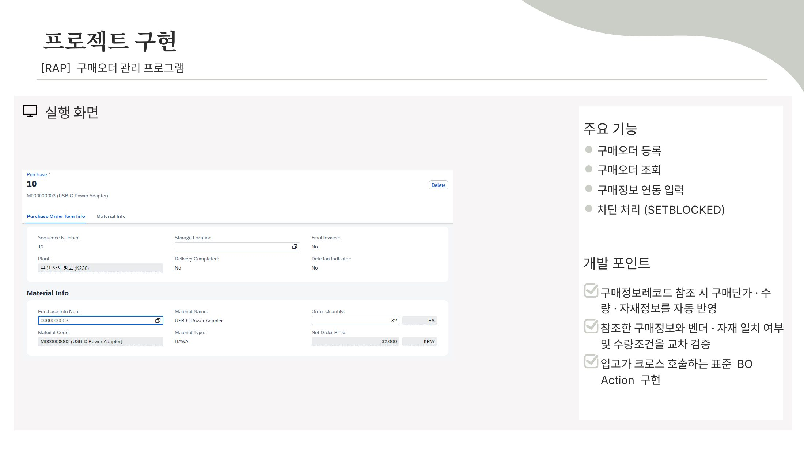
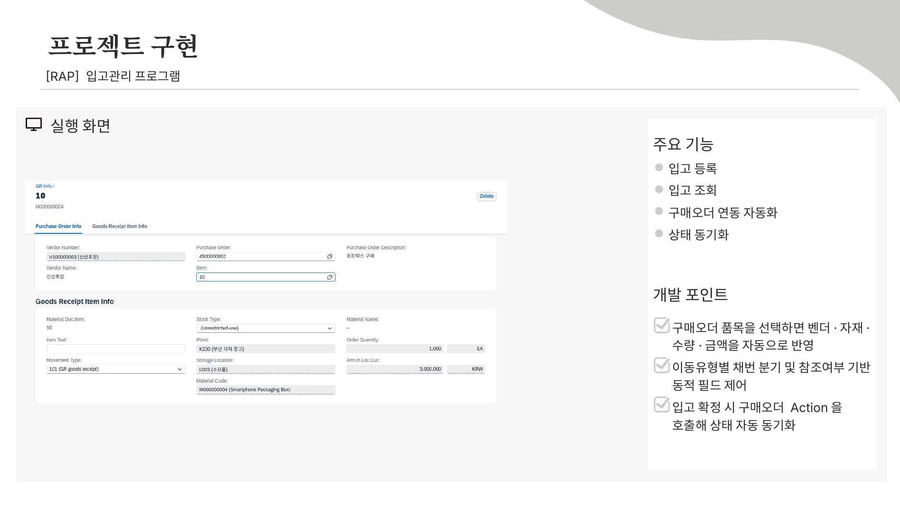
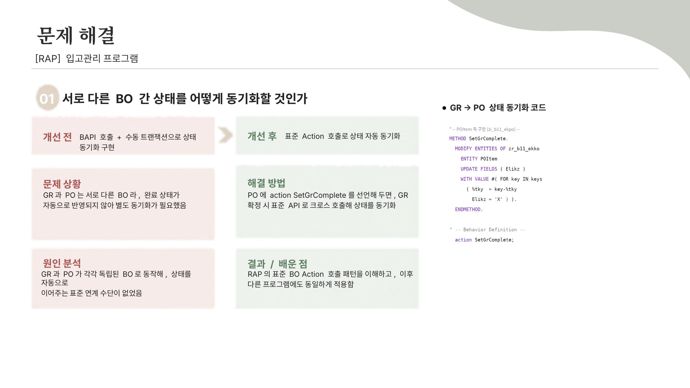
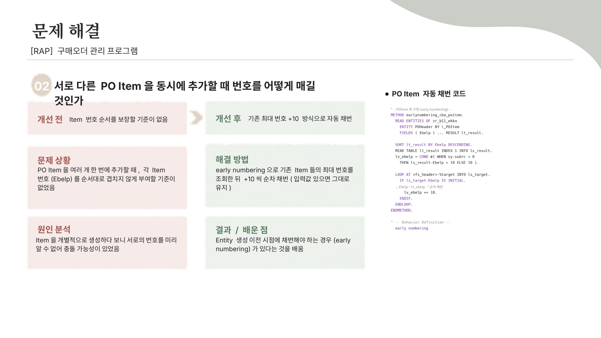

# S-Mobile RAP 기반 S/4HANA 전환 프로젝트 – MM 구매·입고

> SAP KDT 심화과정 2기 프로젝트 (2026.07 ~ 2026.09)
> 가상기업 "S-Mobile"의 기존 시스템을 S/4HANA로 전환하며, 마스터 데이터부터 구매오더·입고까지의 MM 프로세스를 **ABAP Cloud RAP**로 구현

| 항목 | 내용 |
|---|---|
| 역할 | ERD 설계, Business Object 7개 설계·개발 |
| 개발 환경 | SAP BTP ABAP Environment, ABAP Development Tools(Eclipse), abapGit |
| 사용 기술 | ABAP Cloud, RAP(Managed, Draft), CDS View(Interface·Consumption·Metadata Extension), Behavior Definition·Implementation, Service Definition·Binding(OData V4), Number Range |
| 결과 | 7개 BO 일정 내 개발 완료, 조별 평가우수자 선정, 수료식 최종 발표 |

---

## 1. 프로세스와 BO 구성

```
 [마스터 데이터]                                   [구매 프로세스]
 자재(MARA) ─┐
 벤더(LFA1) ─┼──▶ 구매정보 레코드(EINA/EINE) ──▶ 구매오더(EKKO/EKPO) ──▶ 입고(MKPF/MSEG)
 G/L 계정(SKA1) ┘                                      ▲                       │
 계정결정(T030)                                        └─ 입고완료 상태 변경 ◀──┘
```

| BO | 폴더 | Root / Child | Draft | 인스턴스 Action |
|---|---|---|---|---|
| 자재 마스터 | [`material`](src/material) | `ZR_B11_MARA` / 자재 텍스트 | O | 삭제 표시 (`SetLvorm`) |
| 벤더 마스터 | [`vendor`](src/vendor) | `ZR_B11_LFA1` | O | 삭제 표시 |
| G/L 계정 마스터 | [`account`](src/account) | `ZR_B11_SKA1` / 계정 텍스트 | – | 삭제 표시 (`SetRemoved`) |
| 계정결정 | [`determi`](src/determi) | `ZR_B11_T030` | – | 삭제 표시 (`SetRemoved`) |
| 구매정보 레코드 | [`pir`](src/pir) | `ZR_B11_EINA` / 조건(EINE) | O | 구매 차단 (`SetBlocked`) |
| 구매오더 | [`po`](src/po) | `ZR_B11_EKKO` / 품목(EKPO) | O | 구매 차단 (`SetBlocked`), 입고 완료 (`SetGrComplete`) |
| 입고 | [`gr`](src/gr) | `ZR_B11_MKPF` / 품목(MSEG) | O | – |

공통 Value Help용 CDS View 21개(`ZI_B11_*_F4`)는 [`src`](src) 바로 아래에 있습니다.

### BO별 실행 화면과 개발 포인트
각 항목을 펼치면 Fiori Elements 실행 화면과 개발 포인트를 볼 수 있습니다.

<details>
<summary><b>자재 관리 (material)</b></summary>



- 활성 데이터가 있는지에 따라 기준정보 필드를 동적으로 read-only 전환
- Number Range로 "M + 번호" 형식 자재번호 자동 채번
- 생성일 미래 날짜 입력·30일 초과 과거 날짜 등록 방지 검증
- 삭제 표시 Action(`SetLvorm`)
</details>

<details>
<summary><b>벤더 관리 (vendor)</b></summary>



- 계정그룹별 Number Range 분기로 "V + 번호" 자동 채번
- 신규·기존 여부에 따라 필드 편집 권한을 동적 제어
- 외래키 검증으로 연결 계정의 존재·삭제 여부 확인
- 삭제 Action(`SetDelation`)
</details>

<details>
<summary><b>구매정보 레코드 관리 (pir)</b></summary>



- 단가를 입력하지 않으면 자재 표준가격을 자동 적용, 최소주문수량 자동 계산
- 같은 자재 + 벤더 조합의 중복 등록을 사전에 차단(`CheckSemanticKeys`)
- Header 취소 시 하위 Item까지 연쇄 취소(`SetBlocked`)
</details>

<details>
<summary><b>구매오더 관리 (po)</b></summary>



- 구매정보 레코드를 참조하면 단가·수량·자재 정보를 자동 반영
- 참조한 구매정보와 벤더·자재 일치 여부, 수량 조건을 교차 검증
- 입고 BO가 호출하는 입고완료 Action(`SetGrComplete`) 구현
</details>

<details>
<summary><b>입고 관리 (gr)</b></summary>



- 구매오더 품목을 고르면 벤더·자재·수량·금액 자동 반영
- 이동유형별 채번 분기, 구매오더 참조 여부에 따른 동적 필드 제어
- 입고 확정 시 구매오더 Action을 호출해 상태 자동 동기화
</details>

## 2. 주요 구현 내용

### 2-1. UUID 기술키와 업무 번호 분리
- 모든 BO의 Key는 `numbering : managed`로 생성되는 **UUID 기술키**입니다.
- 자재번호·구매오더 번호·입고문서 번호 같은 업무 번호는 저장 시점의 Determination(`SetEbeln`, `NumberingMblnr` 등)에서 Number Range Object(`ZNRB1101`~`ZNRB1105`)로 채번합니다.
- 그래서 Draft로 임시 저장한 데이터는 업무 번호가 생기기 전에도 UUID로 식별됩니다.

### 2-2. 구매오더 → 입고 연계
- **입고 품목 자동 채우기**: 입고 품목에서 구매오더와 품목 번호를 고르면 자재, 플랜트, 저장위치, 수량, 금액, 단위를 구매오더에서 가져옵니다(`SetPoHeader`, `SetPoItem`).
- **Feature Control**: 구매오더 품목을 고르면 위 필드들을 읽기 전용으로 바꿔, 구매오더와 다른 값으로 입고되지 않게 했습니다(`get_instance_features`).
- **저장 전 검증**: 아래 항목을 Validation으로 확인합니다.
  - 필수값
  - 마스터 데이터 존재 여부
  - 구매오더 데이터 일치
  - 수량·금액
  - 통화
  - 구매오더 상태
- **입고완료 상태 변경**: 입고를 저장하면 이동유형 `101`(구매오더 입고) 품목에 한해 구매오더 BO의 `SetGrComplete` Action을 실행해, 해당 구매오더 품목을 입고완료로 바꿉니다(`UpdatePoStatus`).

```abap
" 101 입고만 처리
IF ls_item-Bwart <> '101'.
  CONTINUE.
ENDIF.

" PO 입고완료 처리
MODIFY ENTITIES OF zr_b11_ekko
  ENTITY POItem
  EXECUTE SetGrComplete
  FROM VALUE #( ( EbelnUuid = ls_item-EbelnUuid
                  Ebelp     = ls_item-Ebelp ) ).
```
→ [`zbp_r_b11_mkpf.clas.locals_imp.abap`](src/gr/zbp_r_b11_mkpf.clas.locals_imp.abap) `METHOD UpdatePoStatus`

### 2-3. 구매정보 레코드 → 구매오더 연계
- 구매오더 품목에서 자재와 벤더를 입력하면 구매정보 레코드의 단가와 정보를 가져오고(`SetPIRInfo`), 구매정보 레코드가 있는지 검증합니다(`CheckPIR`).
- 삭제·차단 표시(`Loekz`)된 구매정보 레코드는 구매오더에 쓸 수 없도록 검증합니다.
- 입고에서는 차단되었거나 이미 입고완료(`Elikz`)된 구매오더 품목을 고르지 못하게 막습니다(`CheckPoStatus`).

### 2-4. 계정결정 마스터 (`T030`)
- 이동유형, 평가클래스, 트랜잭션 키, 차대변 지시자별로 G/L 계정을 지정하는 마스터입니다.
- 각 값이 Value Help 마스터에 있는지 저장 전에 검증합니다(`CheckBwart`, `CheckBklas`, `CheckKtosl`, `CheckShkzg`, `CheckSaknr`, `CheckDetermine`).
- 이 마스터는 입고 시 회계 전기에 쓸 계정을 정하기 위한 기반이며, 회계문서 자동 생성은 아직 구현하지 않았습니다. (아래 '향후 과제' 참고)

## 3. 트러블슈팅

| # | 문제 | 원인 | 해결 | 결과 |
|---|---|---|---|---|
| 1 | 입고(GR)와 구매오더(PO)의 완료 상태를 어떻게 맞출 것인가 | GR과 PO가 서로 독립된 BO라 한쪽 상태가 다른 쪽에 자동으로 반영되지 않음 | PO BO에 `SetGrComplete` Action을 선언하고, GR 저장 시 EML(`MODIFY ENTITIES … EXECUTE`)로 호출 | 별도 수동 처리 없이 입고 시 PO 품목이 입고완료로 바뀜. 같은 Action 호출 방식을 다른 BO에도 적용 |
| 2 | 여러 PO Item을 한 번에 추가할 때 품목 번호(`Ebelp`)가 겹칠 수 있음 | Item을 각각 생성해 서로의 번호를 미리 알 수 없음 | Early Numbering에서 기존 Item의 최대 번호를 조회한 뒤 +10씩 순서대로 채번 (직접 입력한 번호는 유지) | 번호가 겹치지 않고 10, 20, 30… 순서로 부여됨 |

<details>
<summary>트러블슈팅 발표 자료 보기</summary>



</details>

## 4. 폴더 구조 (abapGit 형식)

```
sap-kdt-rap-project/
├── .abapgit.xml          # abapGit 저장소 설정 (STARTING_FOLDER = /src/)
└── src/
    ├── material/ vendor/ account/ determi/ pir/ po/ gr/   # BO별 하위 패키지
    │   ├── ztb11*.tabl.xml           # 활성 테이블 · Draft 테이블
    │   ├── zr_b11_*.ddls.asddls      # Root/Interface CDS View
    │   ├── zc_b11_*.ddls.asddls      # Consumption(Projection) CDS View
    │   ├── zc_b11_*.ddlx.asddlxs     # Metadata Extension (UI 어노테이션)
    │   ├── zr_b11_*.bdef.asbdef      # Behavior Definition
    │   ├── zbp_r_b11_*.clas.*.abap   # Behavior Implementation
    │   └── zui_b11_*.srvd / .srvb    # Service Definition · Binding (OData V4)
    ├── zi_b11_*_f4.ddls.asddls        # 공통 Value Help CDS View
    └── zmcb11.msag.xml                # 메시지 클래스
images/                                # 발표 자료의 실행 화면·트러블슈팅 슬라이드
```

- abapGit으로 내보낸 원본 구조를 그대로 두었습니다. 이 폴더만 별도 저장소로 옮기면 abapGit으로 다시 가져올 수 있습니다.

## 5. 향후 과제
- **입고 시 회계문서 자동 생성**: 계정결정(T030) 마스터를 기준으로 입고 금액의 차변(재고)·대변(GR/IR) 계정을 결정해 회계문서를 만드는 로직을 추가할 계획입니다.
